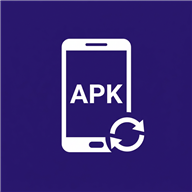

<div align="center">



# APKUpdater OSS

**Open-source Android app update manager across independent stores and git repositories**

<p>
  <a href="https://github.com/EikeiDev/apkupdateross/releases/latest">
    
  </a>
  <a href="https://github.com/EikeiDev/apkupdateross/releases">
    
  </a>
  
  
  <a href="LICENSE">
    
  </a>
</p>

<p>
  <a href="README.md">🇷🇺 Русский</a> &nbsp;·&nbsp; <strong>🇬🇧 English</strong>
</p>

<p>
  <a href="#features">Features</a> &nbsp;·&nbsp;
  <a href="#update-sources">Sources</a> &nbsp;·&nbsp;
  <a href="#settings">Settings</a> &nbsp;·&nbsp;
  <a href="#installation">Installation</a> &nbsp;·&nbsp;
  <a href="#build-from-source">Build</a> &nbsp;·&nbsp;
  <a href="#support-development">Support</a>
</p>

</div>

---

**APKUpdater OSS** helps you discover, download, and install Android app updates without being locked into a single store. It queries multiple independent sources in parallel, groups matching updates into one clean card per app, and gives you full control over where your updates come from.

This project is a heavily reworked fork of the original [APKUpdater](https://github.com/rumboalla/apkupdater) by [rumboalla](https://github.com/rumboalla). It uses the `com.apkupdateross` package ID so it can coexist alongside the original app, and supports phones, tablets, and Android TV devices.

---

## Features

### Update Discovery & Control
- **13 update sources in one place** — matching updates from multiple stores are grouped into a single card where you can switch sources in one tap.
- **Source priority & per-app pinning** — define your preferred ranking order when versions match, or pin a specific source for any individual app.
- **Release type filtering** — clear `Stable`, `Beta`, `Alpha`, and `Pre-release` badges with independent toggles to hide pre-release builds.
- **Flexible sorting & filtering** — sort apps and updates, filter by source, run single-app checks from the `Apps` tab, stop an active scan, or retry failed sources individually.
- **Ignore controls & gestures** — hide specific versions or entire apps using buttons or configurable swipe gestures.
- **Smart custom git repositories** — paste a GitHub, GitLab, or Codeberg URL (or share it directly from your browser) to automatically detect the package, releases, and compatible APK.

### Installation & Packages
- **Three install modes** — standard Android `Session Installer`, **Root**, and **Shizuku** with live permission/access diagnostics.
- **Batch updates** — install all available updates at once via the `Update all` action.
- **Local package installer** — install local `APK`, `XAPK`, `APKS`, and `APKM` archives using your active install mode, either from Settings or via Android's "Open with" menu.
- **APK backup** — export installed apps directly from the `Apps` tab to your downloads folder (including packing split APKs into `.apks`).
- **Clear failure diagnostics** — human-readable error messages for signature mismatches, low storage, device/Android incompatibility, downgrade blocks, and corrupted APKs.
- **History & self-updates** — full update/install activity log plus built-in self-update dialogs with formatted changelogs.

### Automation & Networking
- **Scheduled background checks** — configurable frequency, check hour, and Wi-Fi-only option.
- **Unattended auto-install** — automatically download and install updates in the background via Root or Shizuku (with an optional Wi-Fi-only install guard).
- **Granular notifications** — separate toggles for available updates, successful auto-installs, errors, and no-update checks.
- **Proxy & timeouts** — global HTTP / SOCKS5 proxy support (with optional credentials and built-in latency test), default source timeout, and dedicated Google Play timeout.

### Interface & Customization
- **Material 3 & Material You** — System, Dark, Light, and Custom themes (accent, background, cards, bottom bar) plus dynamic colors on Android 12+.
- **Adaptive layouts** — compact mode and customizable portrait/landscape grid column counts.
- **In-app language switcher** — switch between System, English, and Russian without changing the device language.
- **Data & diagnostics** — custom download folder picker, download and store cache cleanup, settings backup/restore (excluding secrets), and one-tap app list / log export.

---

## Update Sources

### Code Repositories

| Source | Default | Capabilities |
| --- | :---: | --- |
| **GitHub** | On | Releases, `pre-release` detection, URL auto-detection, custom repositories, optional API token |
| **GitLab** | On | Releases, URL auto-detection, custom repositories, optional API token |
| **Codeberg** | On | Releases, URL auto-detection, custom repositories, optional API token |

### App Stores

| Source | Default | Capabilities |
| --- | :---: | --- |
| **Google Play** | On | Search & updates via Aurora GPlayApi, device language support, automatic session rotation on HTTP 429 |
| **RuStore** | On | Search, updates, changelogs, direct downloads, and 404 cache reset |
| **F-Droid / IzzyOnDroid** | On | Built-in and custom F-Droid repositories, suggested/stable release checks |
| **APKPure** | On | Search, updates, and release filtering |
| **Aptoide** | On | Search and updates from the public catalog |
| **APKMirror** | Off | Search, updates, `APKM` / split packages, ABI matching, and interactive Cloudflare verification |
| **APK20** | Off | Search, APK variants, and compatibility checks |
| **Uptodown** | Off | Search, `APK` / `XAPK` / `APKS`, direct download, and WebView fallback |
| **AppGallery (Huawei)** | Off | Search and updates with full region picker (`Auto` or any ISO country) |
| **Galaxy Store (Samsung)** | Off | Search and updates for International and China (CN) catalogs |

> [!NOTE]
> Sources marked **Off** can be enabled anytime in **Settings → Sources**. Third-party stores rely on public APIs or web pages and may occasionally rate-limit or change structure on their end.

---

## Settings

| Category | What's Inside |
| --- | --- |
| **Sources** | App stores, GitHub / GitLab / Codeberg tokens, custom git & F-Droid repositories, AppGallery & Galaxy Store regions |
| **Updates** | `Alpha` / `Beta` / `Pre-release` filters, source priority, pinned app sources, startup check, ignored updates, history, and metrics |
| **Notifications** | Background check schedule, Wi-Fi-only checks, automatic installation (Root / Shizuku), and notification event toggles |
| **Install** | Installation method (System installer, Root, Shizuku) and live access checks |
| **Interface** | In-app language, theme & Material You, custom colors, swipe gestures, text animations, compact mode, and grid columns |
| **Network** | Default source & Google Play timeouts, HTTP / SOCKS5 proxy configuration, and connection test |
| **Data & diagnostics** | Local package installer, save folder selection, cache cleanup, settings export/import, app list & log copy |
| **About** | App version, GitHub & donation links, GPL v3.0 license, and credits |

---

## Installation

1. Open **[Releases](https://github.com/EikeiDev/apkupdateross/releases/latest)**.
2. Download `com.apkupdateross-release.apk`.
3. Install the APK and allow installs from unknown sources if prompted by Android.

**Requirements:** Android **7.0 Nougat (API 24)** or newer.

> [!IMPORTANT]
> Debug and Release builds use different signing keys, so Android cannot install a release APK over a debug build. To switch, export your settings, uninstall the debug build, install the release APK, and import your settings back.

---

## Build from Source

Requires **JDK 17** and **Android SDK (compileSdk 35)**.

```bash
# Windows
.\gradlew.bat testDebugUnitTest assembleDebug
.\gradlew.bat assembleRelease

# Linux / macOS
./gradlew testDebugUnitTest assembleDebug
./gradlew assembleRelease
```

Output APKs are generated at:

```text
app/build/outputs/apk/debug/com.apkupdateross-debug.apk
app/build/outputs/apk/release/com.apkupdateross-release.apk
```

<details>
<summary><strong>Release signing configuration (local.properties)</strong></summary>

`assembleRelease` requires a signing keystore configured in `local.properties` at the project root:

```properties
keystore.file=release.jks
keystore.password=your_store_password
keystore.keyalias=your_key_alias
keystore.keypassword=your_key_password
```

Without these properties, `assembleRelease` will fail with a configuration error, while `assembleDebug` builds using the standard debug keystore.

</details>

---

## Security & Privacy

- **Zero ads, zero telemetry** — no ad SDKs, trackers, or analytics are included.
- **Direct from sources** — APKUpdater OSS is not an app store and does not host APK files; all metadata and downloads come directly from the sources you enable.
- **Safe settings export** — API tokens (GitHub, GitLab, Codeberg), proxy credentials, Google Play auth data, and transient caches are automatically excluded from exported backups.
- **Transparent installs** — in standard mode, Android always prompts for install confirmation; unattended installs are only active when you explicitly configure Root or Shizuku.

> [!TIP]
> Always verify the selected source inside an update card before installing, especially when an update is sourced from a third-party catalog rather than the developer's official release page.

---

## Support Development

If **APKUpdater OSS** is useful to you, consider supporting continued development:

| Method | Details |
| --- | --- |
| **DonationAlerts** | [donationalerts.com/r/eikeidev](https://www.donationalerts.com/r/eikeidev) |
| **BTC** | `12E586ZRxrYDTPy6A1LDHQ1AvZku6Ggx9x` |
| **GRAM / TON** | `UQDgDs-0LDZFFq54ZR3UtJAIK_oSfT4cmkY-tyjeMSxcSX1i` |
| **USDT** | `0xc75986e1460cc232f74b9a600b9c0e41dfa644f7` |

> [!CAUTION]
> Always double-check the transfer network in your wallet before sending cryptocurrency.

---

## Translations & License

The app ships with full **English** and **Russian** localizations, verified for key and placeholder parity via automated unit tests.

- **APKUpdater OSS** — Copyright © 2026 [NotDev (EikeiDev)](https://github.com/EikeiDev)
- **Original APKUpdater** — Copyright © 2016–2024 [rumboalla](https://github.com/rumboalla)

Licensed under the **[GNU General Public License v3.0](LICENSE)**.
